

<a href="https://kennurken.github.io"><picture><source media="(prefers-color-scheme: dark)" srcset="assets/hero-dark.svg"><source media="(prefers-color-scheme: light)" srcset="assets/hero-light.svg"></picture></a>

 

<picture><source media="(prefers-color-scheme: dark)" srcset="assets/sec-work-dark.svg"><source media="(prefers-color-scheme: light)" srcset="assets/sec-work-light.svg"></picture>

<a href="https://github.com/Kennurken/phoecord"><picture><source media="(prefers-color-scheme: dark)" srcset="assets/card-phoecord-dark.svg"><source media="(prefers-color-scheme: light)" srcset="assets/card-phoecord-light.svg"></picture></a>

 

<picture><source media="(prefers-color-scheme: dark)" srcset="assets/card-csa-dark.svg"><source media="(prefers-color-scheme: light)" srcset="assets/card-csa-light.svg"></picture>

 

<picture><source media="(prefers-color-scheme: dark)" srcset="assets/card-zofu-dark.svg"><source media="(prefers-color-scheme: light)" srcset="assets/card-zofu-light.svg"></picture>

 

<picture><source media="(prefers-color-scheme: dark)" srcset="assets/card-vq-dark.svg"><source media="(prefers-color-scheme: light)" srcset="assets/card-vq-light.svg"></picture>

 

<picture><source media="(prefers-color-scheme: dark)" srcset="assets/sec-more-dark.svg"><source media="(prefers-color-scheme: light)" srcset="assets/sec-more-light.svg"></picture>

<a href="https://github.com/Kennurken/wallet"><picture><source media="(prefers-color-scheme: dark)" srcset="assets/tile-1-dark.svg"><source media="(prefers-color-scheme: light)" srcset="assets/tile-1-light.svg"></picture></a> <a href="https://github.com/Kennurken/qalqan-ai"><picture><source media="(prefers-color-scheme: dark)" srcset="assets/tile-2-dark.svg"><source media="(prefers-color-scheme: light)" srcset="assets/tile-2-light.svg"></picture></a>

<a href="https://github.com/Kennurken/kazgpt-ai-assistant"><picture><source media="(prefers-color-scheme: dark)" srcset="assets/tile-3-dark.svg"><source media="(prefers-color-scheme: light)" srcset="assets/tile-3-light.svg"></picture></a> <a href="https://github.com/Kennurken/tender-tracker"><picture><source media="(prefers-color-scheme: dark)" srcset="assets/tile-4-dark.svg"><source media="(prefers-color-scheme: light)" srcset="assets/tile-4-light.svg"></picture></a>

<a href="https://github.com/Kennurken/LiveWall"><picture><source media="(prefers-color-scheme: dark)" srcset="assets/tile-5-dark.svg"><source media="(prefers-color-scheme: light)" srcset="assets/tile-5-light.svg"></picture></a> <a href="https://github.com/Kennurken?tab=repositories"><picture><source media="(prefers-color-scheme: dark)" srcset="assets/tile-6-dark.svg"><source media="(prefers-color-scheme: light)" srcset="assets/tile-6-light.svg"></picture></a>

 

<picture><source media="(prefers-color-scheme: dark)" srcset="assets/sec-stack-dark.svg"><source media="(prefers-color-scheme: light)" srcset="assets/sec-stack-light.svg"></picture>

<picture><source media="(prefers-color-scheme: dark)" srcset="assets/stack-dark.svg"><source media="(prefers-color-scheme: light)" srcset="assets/stack-light.svg"></picture>

 

<picture><source media="(prefers-color-scheme: dark)" srcset="assets/sec-activity-dark.svg"><source media="(prefers-color-scheme: light)" srcset="assets/sec-activity-light.svg"></picture>

<picture><source media="(prefers-color-scheme: dark)" srcset="https://raw.githubusercontent.com/Kennurken/Kennurken/output/github-contribution-grid-snake-dark.svg"></picture>

  

<picture><source media="(prefers-color-scheme: dark)" srcset="assets/footer-dark.svg"><source media="(prefers-color-scheme: light)" srcset="assets/footer-light.svg"></picture>

 

artwork is generated by <a href="tools/gen.py"><code>tools/gen.py</code></a> · dark & light themes

